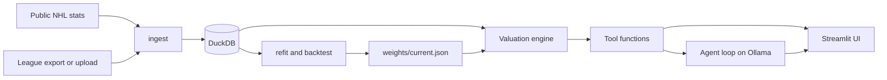

# Dynasty-Maker
A local-first fantasy hockey GM assistant for dynasty leagues. It measures how strong a roster is, ranks it against every other team in the league, and explains what to do about it. The language model runs on your own machine through Ollama.

**Status: specification only. No code exists yet.** This README is the build spec. Coding agents working in this repo should read all of it before writing anything, then follow [Build order](#build-order).

## What it must answer

- How strong is my roster this season, and over the next three?
- Where do I rank against each other team, overall and by category and position?
- Am I a contender, or should I be rebuilding?
- Is this trade good for me? Who should I target, and who should I sell?
- Which free agents would improve my lineup?

## Ground rules for agents

1. **Numbers come from code, never from the language model.** The model picks which tool to call and explains the result. It does not add, rank, project or estimate anything itself.
2. **Local-first.** At runtime the only network calls are data fetches from public stats sources. No cloud LLM.
3. **League rules are configuration.** Scoring, roster slots and league size live in `config/league.yaml`. Never hardcode them.
4. **Every result is stamped** with `as_of` (date of the newest data used) and `weights_version`.
5. **Deterministic.** Same data and same weights give the same output. Any simulation takes an explicit seed.
6. **One source of logic.** The agent tools and the UI call the same functions in `dynasty/tools.py`. Neither contains valuation logic.
7. **Raw data is never committed.** Only synthetic fixtures under `tests/fixtures/` and weights files under `weights/` go into git.
8. **Stay inside the listed stack.** Adding a dependency needs a stated reason in the pull request.
9. **Build in order.** Do not start a work package until the acceptance checks of the ones it depends on pass.

## Architecture



## Tech stack

| Layer | Choice | Notes |
|---|---|---|
| Language | Python 3.12 or newer | Managed with `uv` (`uv sync`, `uv run`) |
| LLM runtime | Ollama | Official `ollama` Python package, native tool calling, no agent framework |
| Storage | DuckDB, one file | Raw fetches are also kept as dated Parquet snapshots |
| Data handling | pandas plus DuckDB SQL | |
| Modelling | numpy, scipy, scikit-learn | |
| Schemas | pydantic v2 | Config, weights file, and every tool input and output |
| CLI | Typer | Entry point `dynasty` |
| UI | Streamlit | Phase 2, see [User interface](#user-interface) |
| Quality | ruff, pytest | |
| CI | GitHub Actions | See [Data updates and CI/CD](#data-updates-and-cicd) |

## Repository layout

```text
config/
  league.yaml          league rules (scoring, slots, teams)
  settings.yaml        model name, data dir, agent limits
dynasty/
  config.py            pydantic models for both config files
  db.py                DuckDB connection and schema migrations
  ingest/              nhl.py, league_csv.py, later one module per platform
  projections.py       player projections
  valuation.py         player value, replacement level, dynasty value
  roster.py            lineup optimisation, roster strength
  league.py            versus-the-field comparison, tiers
  trades.py            trade evaluation and target search
  weights.py           load, validate, refit, promote
  backtest.py          walk-forward evaluation
  tools.py             the functions the agent and UI call
  agent/               loop.py, prompts.py, schemas.py
  cli.py
ui/                    Streamlit app (phase 2)
weights/               versioned weights JSON plus current.json
tests/
  fixtures/            small synthetic league and stats
  golden/              agent evaluation questions
.github/workflows/
```

## League configuration

`config/league.yaml` describes one league. Both scoring styles must be supported from the start because they change every downstream calculation.

```yaml
name: Example Dynasty
teams: 12
my_team: team_03
format: categories          # categories | points
matchup: h2h                # h2h | roto
categories:
  skater: [G, A, PPP, SOG, HIT, BLK]
  goalie: [W, SV_PCT, GAA]
points: {}                  # used when format is points, e.g. {G: 3, A: 2}
roster:
  C: 2
  LW: 2
  RW: 2
  D: 4
  G: 2
  UTIL: 1
  BENCH: 5
  IR: 2
  MINORS: 10
dynasty:
  horizon_years: 3
  tracks_picks: true
  tracks_prospects: true
```

## Data

### Sources

| Data | Source | Used for |
|---|---|---|
| Player bio, season stats, game logs, schedule | NHL public web endpoints | Projections |
| League rosters, picks, standings | CSV export or upload first, platform adapters later | Everything league-specific |
| Advanced stats (ice time splits, expected goals) | Optional, for example MoneyPuck CSV downloads | Better projections, later |

The NHL endpoints are undocumented. Work package 2 must confirm the current URLs and terms of use, record sample responses as test fixtures, and keep all fetching behind `dynasty/ingest/nhl.py` so a change breaks one file.

### Storage

All runtime data lives in the directory named by `DYNASTY_DATA_DIR`. **Set this to a folder outside OneDrive.** This repo currently sits in a OneDrive folder, and a synced DuckDB file invites lock and conflict errors.

Minimum tables:

- `players`: NHL id, name, birth date, positions, NHL team
- `skater_game_stats`, `goalie_game_stats`: one row per player per game
- `fantasy_teams`, `roster_entries`: dated snapshots, so history is kept
- `draft_picks`: owner, season, round, original owner
- `projections`: per player, season, `weights_version`, `as_of`
- `ingest_log`: file or source, hash, row counts, outcome

### Ingest contract

- League files go in `$DYNASTY_DATA_DIR/inbox/`. `dynasty ingest` validates, loads, then moves each file to `processed/` or `rejected/`.
- `rosters.csv` columns: `team_id, team_name, player_id, player_name, position, nhl_team, status`. `player_id` is the NHL id and may be blank, in which case the row is matched on name, position and NHL team.
- A file with any unmatched or invalid row is rejected whole, with a row-by-row error report. Nothing is loaded partially.
- Ingest is idempotent. Loading the same file twice changes nothing.
- A free agent is any NHL player not on a roster in the latest snapshot. No separate file.

## Valuation engine

### Projections

Start simple and measurable, then improve.

- Baseline: a weighted average of the last three seasons' per-game rates, regressed toward the positional mean according to games played, adjusted by an age curve, multiplied by projected games.
- Rest of season: blend the preseason projection with the current season's rate. The current season's share grows with games played.
- Goalies are projected separately (starts, save percentage, goals against) with much heavier regression.
- Every parameter above lives in the weights file, not in code.

### Player value

- **Points leagues:** projected fantasy points above replacement. Replacement level at a position is the best player who would be unrostered given league size and slots.
- **Category leagues:** sum of per-category z-scores above replacement, times category weights. Ratio categories such as save percentage are weighted by volume.
- **Dynasty value:** the discounted sum of projected season values over `horizon_years`, using the age curve for future seasons. Prospects and draft picks take their value from a lookup table in the weights file until there is data to fit one.

### Roster strength

For one team, `roster.py` produces:

- `now_score`: projected rest-of-season output of the optimal lineup, respecting slots and position eligibility
- `depth_score`: how much output is lost when each starter is replaced by the next best option
- `future_score`: dynasty value of the full roster, including prospects and picks
- An age profile (value-weighted average age) and a breakdown by position group and by category

### Versus the field

`league.py` computes the above for all teams and returns:

- Rank and percentile for now, future and depth
- Category leagues: rank in each category, plus expected roto points or expected category wins against each opponent
- Points leagues: projected weekly points and win probability against each opponent
- A tier for each team (contender, bubble, rebuild) from now-rank and future-rank, with thresholds in the weights file
- Each team's weakest categories and positions relative to the league, which feeds trade targeting

### Trades

A trade is evaluated by recomputing both teams' roster strength before and after, not by summing player values. This captures lineup effects, such as a third goalie adding nothing to a team that starts two. Output: change in now, future and league rank for both sides.

## Weights

"Weights" in this project means the parameters of the valuation engine. **It does not mean the language model's weights.** Uploading new data never retrains the LLM, and it does not need to: the model only routes questions and explains results. What new data changes is the projections and the fitted parameters below.

`weights/<version>.json`, with `weights/current.json` naming the active version:

```json
{
  "version": "2026-11-16.1",
  "trained_through": "2026-11-15",
  "projection": {
    "season_weights": [5, 4, 3],
    "regression_games": {"F": 60, "D": 60, "G": 40},
    "ros_blend_games": 40
  },
  "age_curve": {"F": {}, "D": {}, "G": {}},
  "dynasty": {"discount": 0.85, "pick_values": {}, "prospect_values": {}},
  "category_weights": {},
  "tiers": {"contender_top_n": 4, "rebuild_bottom_n": 4},
  "backtest": {"metric": "mae_per_game", "candidate": null, "naive_baseline": null}
}
```

The numbers shown are placeholders to start from, not fitted values. The first refit replaces them.

Updating weights:

1. `dynasty refit` fits the parameters by walk-forward backtest (train on seasons up to N-1, test on season N) and writes a candidate file.
2. The candidate is accepted only if its backtest error is no worse than the current version's, within a tolerance set in `settings.yaml`.
3. `dynasty promote <version>` points `current.json` at it.
4. Weights files are small and are committed, so every change is a reviewable diff and rollback is a revert.

## Agent

### Model

Set in `config/settings.yaml`; never hardcoded. Requirements: advertises `tools` under Capabilities in `ollama show <model>`, and fits the available GPU.

- This machine has an RTX 5070 Ti (16 GB) and 31 GB of RAM.
- The installed `llama3:latest` reports `completion` only, so **it cannot be used**.
- Candidates in the Ollama library with tool support at a size that should fit, as of 2026-11-16: `mimo-v2.6` (9b), `ornith-1.5` (9b), `bonsai-2` (9b). `qwen3.8` (27b) may be too large for 16 GB. None has been tested here. Work package 6 picks one by running the golden questions against each.

### Loop

A plain loop over `ollama.chat(model, messages, tools)`: send the question, execute any tool calls, feed back the JSON, repeat until the model answers or a round limit (default 8) is hit. Low temperature. Tool outputs are kept compact (top rows only, rounded numbers) so they fit the context window.

### Tools

All in `dynasty/tools.py`, each with pydantic input and output models.

| Tool | Returns |
|---|---|
| `data_status()` | Newest data date, weights version, last ingest results |
| `league_table(horizon)` | All teams ranked for `now` or `future`, with tier |
| `team_report(team)` | Scores, ranks, strengths, weaknesses, age profile |
| `compare_teams(team_a, team_b)` | Side by side by category and position, win probability |
| `find_player(query)` | Matching players with ids, for resolving names |
| `player_value(player_id)` | Projection, value now, dynasty value, positional rank |
| `evaluate_trade(team_a, a_gives, team_b, b_gives)` | Before and after for both teams |
| `trade_targets(team, need)` | Players on other rosters who fix a stated weakness, and what each owner needs |
| `free_agents(team, position, limit)` | Unrostered players ranked by lineup improvement for that team |

### Behaviour rules (enforced in the system prompt and checked by tests)

- Every number in an answer must appear in a tool result from the same conversation.
- Resolve every player and team name through a tool before using it. Never invent a player.
- State the data date. If `data_status` shows data older than a threshold in `settings.yaml`, say so before answering.
- If the tools cannot answer the question, say that instead of guessing.

### Evaluation

`tests/golden/` holds about 20 questions against the fixture league, each with the expected tool calls and the numbers the answer must contain. These tests need Ollama, are marked `ollama`, and are skipped on GitHub-hosted runners.

## Data updates and CI/CD

One constraint drives this design: GitHub-hosted runners cannot reach your local data or your local Ollama. So the pipeline is split.

**On GitHub (every push and pull request), `ci.yml`:** `uv sync`, `ruff check`, `pytest` against fixtures. No network, no Ollama.

**On GitHub (when `weights/**` changes), `weights.yml`:** validate the file against its schema and rerun the backtest on fixture data. Fail on schema errors or a regression.

**On this machine:**

| Step | Command | Trigger |
|---|---|---|
| Pull public stats | `dynasty refresh` | Nightly, via Windows Task Scheduler |
| Load league files | `dynasty ingest` | After dropping files in the inbox, or from the UI upload page |
| Recompute projections | `dynasty project` | Automatically after either of the above |
| Refit weights | `dynasty refit` then `dynasty promote` | Weekly, or on demand |
| Agent evaluation | `pytest -m ollama` | Before changing the model or the prompts |
| Deploy | `git pull`, `uv sync`, `dynasty migrate`, restart the UI | After a merge to `main` |

The local steps can be automated with a GitHub self-hosted runner installed on this PC. **Only do that if the repository is private.** A self-hosted runner on a public repository lets a pull request from a stranger run code on your machine.

## User interface

Phase 2. Built only after work package 6 passes, so the tools it depends on are stable. Streamlit, with no logic of its own:

- **League:** power rankings for now and future, tiers
- **My team:** the team report, strengths and weaknesses
- **Compare:** two teams side by side
- **Trade:** pick players on each side, see before and after
- **GM chat:** the agent, showing which tools it called
- **Data:** file upload into the inbox, data status, active weights version

## Build order

| # | Work package | Depends on | Done when |
|---|---|---|---|
| 0 | Scaffold: `pyproject.toml`, package skeleton, ruff, pytest, `ci.yml` | none | `uv run ruff check` and `uv run pytest` pass locally and in CI |
| 1 | Config models, DuckDB schema, CSV league ingest, synthetic fixture league | 0 | Fixtures load; a bad file is rejected whole with row errors; re-ingest is a no-op |
| 2 | NHL stats fetch and `dynasty refresh` | 1 | Tests run against recorded responses; snapshots are saved; a rerun adds no duplicates |
| 3 | Projections, backtest, first weights file | 2 | Walk-forward backtest beats a "repeat last season" baseline, and the result is written into the weights file |
| 4 | Player value, roster strength, versus the field | 3 | Output matches hand-computed values on the fixture league; adding a better player never lowers a team's score |
| 5 | Trade evaluation, trade targets, free agents | 4 | A trade and its reverse give opposite deltas; a surplus player adds nothing to `now_score` |
| 6 | Tools, agent loop, golden questions, model selection | 5 | At least 18 of 20 golden questions call the right tools and quote only numbers from tool output |
| 7 | Refit, promote, `weights.yml`, scheduled refresh | 3 | A worse candidate is refused; a better one is promoted; rollback works |
| 8 | Streamlit UI | 6 | Every page renders against the fixture league, and upload reaches the same ingest path as the CLI |

## Open decisions

These need an answer from the league owner. Agents should not guess them.

1. **League platform** (Fantrax, Yahoo, ESPN, other). Decides which adapter follows the CSV one.
2. **Scoring format, categories and roster slots.** Needed to fill in `league.yaml`.
3. **Dynasty rules:** minors or farm system, draft picks, contracts or a salary cap.
4. **Is the GitHub repository private?** Decides whether a self-hosted runner is safe.
5. **Model.** Settled by the bake-off in work package 6.

## License

Apache 2.0. See [LICENSE](./LICENSE).
