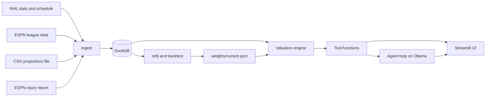

# Dynasty-Maker

A local-first fantasy hockey GM assistant for one ESPN league. It measures how strong a roster is, ranks it against the other eleven teams, and explains what to do about it: lineups, trades and free agents. The language model runs on your own machine through Ollama.

**Scope: the 2026-27 season only.** Everything here is about winning this year. Keeper planning for next season is deliberately left out for now, see [Later](#later).

**Status: specification only. No code exists yet.** This README is the build spec. Coding agents working in this repo should read all of it before writing anything, then follow [Build order](#build-order).

## What it must answer

- How strong is my roster for the rest of this season?
- Where do I rank against each other team, and what are my playoff odds?
- Is this trade good for me? Who should I target, and who should I sell?
- Which free agents would improve my lineup this week?

## Ground rules for agents

1. **Numbers come from code, never from the language model.** The model picks which tool to call and explains the result. It does not add, rank, project or estimate anything itself.
2. **Local-first.** At runtime the only network calls are data fetches from ESPN and public NHL stats. No cloud LLM.
3. **Read-only against ESPN.** This project advises. It never sets lineups, makes claims or proposes trades on ESPN.
4. **Treat this repository as public.** No ESPN cookies, league id, owner names or real league data in git, in test fixtures, in logs or in commit messages. Third-party data files, such as the projections spreadsheet and the injury report, are not committed either. Secrets live in `.env`, which is gitignored.
5. **League rules are configuration.** Scoring, roster slots and schedule rules live in `config/league.yaml`. Never hardcode them.
6. **Every result is stamped** with `as_of` (date of the newest data used) and `weights_version`.
7. **Deterministic.** Same data and same weights give the same output. Every simulation takes an explicit seed.
8. **One source of logic.** The agent tools and the UI call the same functions in `dynasty/tools.py`. Neither contains valuation logic.
9. **Stay inside the listed stack.** Adding a dependency needs a stated reason in the pull request.
10. **Build in order.** Do not start a work package until the acceptance checks of the ones it depends on pass.

## Architecture



## Tech stack

| Layer | Choice | Notes |
|---|---|---|
| Language | Python 3.12 or newer | Managed with `uv` (`uv sync`, `uv run`) |
| LLM runtime | Ollama | Official `ollama` Python package, native tool calling, no agent framework |
| League data | `espn-api` (hockey module) | Unofficial ESPN client; private leagues need two browser cookies |
| Storage | DuckDB, one file | Raw fetches are also kept as dated Parquet snapshots |
| Data handling | pandas plus DuckDB SQL | |
| Modelling | numpy, scipy, scikit-learn | |
| Schemas and settings | pydantic v2, pydantic-settings | Config, `.env`, weights file, every tool input and output |
| CLI | Typer | Entry point `dynasty` |
| UI | Streamlit | Phase 2, see [User interface](#user-interface) |
| Quality | ruff, pytest | |
| CI | GitHub Actions | See [Data updates and CI/CD](#data-updates-and-cicd) |

## Repository layout

```text
config/
  league.yaml          league rules (scoring, slots, schedule)
  settings.yaml        model name, agent limits, tier thresholds
  teams.csv            each NHL team's full name, ESPN code and NHL code
  player_aliases.csv   manual fixes for player matching
.env.example           names of the required secrets, no values
dynasty/
  config.py            pydantic models for config and .env
  db.py                DuckDB connection and schema migrations
  identity.py          player keys and the one resolver every source uses
  ingest/              nhl.py, espn.py, league_csv.py, projections_csv.py, injuries.py
  scoring.py           stat line to fantasy points
  projections.py       player projections
  valuation.py         replacement level, player value
  lineup.py            schedule-aware daily lineups
  roster.py            roster strength
  league.py            versus the field, season simulation, tiers
  trades.py            trade evaluation, targets, free agents
  weights.py           load, validate, refit, promote
  backtest.py          walk-forward evaluation
  tools.py             the functions the agent and UI call
  agent/               loop.py, prompts.py, schemas.py
  cli.py
ui/                    Streamlit app (phase 2)
weights/               versioned weights JSON plus current.json
tests/
  fixtures/            synthetic 12-team league, recorded API responses
  golden/              agent evaluation questions
.github/workflows/
```

## League configuration

This is the league the project is built for. Work package 1 creates `config/league.yaml` with exactly this content.

```yaml
platform: espn
espn_season: 2027           # ESPN names a season by the year it ends: 2027 is 2026-27
teams: 12
format: points
matchup: h2h
lineup: daily               # each player locks at his own game time
roster:
  slots: {F: 9, D: 5, UTIL: 1, G: 2, BENCH: 5, IR: 1}
  max_goalies: 4
scoring:
  skater: {G: 3, A: 2, PPP: 0.5, SHP: 1, GWG: 0.5, HAT: 0.5, SOG: 0.2, HIT: 0.3, BLK: 0.6}
  goalie: {W: 2, L: -0.25, OTL: 0.5, GA: -1, SV: 0.2, SO: 0.5}
transactions:
  acquisitions_per_matchup: 2
  waiver_days: 1
  trade_deadline: 2027-02-26T12:00
schedule:
  matchup_length_weeks: 1
  regular_season_matchups: 25
  playoff_teams: 4
  playoff_rounds: 2
  ties_stand: true
  seeding_tiebreaker: head_to_head
```

Notes on reading it:

- Forwards are one pool. C, LW and RW are not separate slots. UTIL takes any skater.
- PPP, SHP, GWG and HAT are bonuses on top of the goal or assist. A power-play goal is 3.5 before the shot.
- There are no contracts, no salary cap, no minors and no tradable draft picks. Do not model them.
- Worked examples for the scoring tests: a 30-save win with 2 goals against is 6.0 (6 + 2 - 2). A power-play goal on one shot is 3.7.

`.env` (gitignored) holds what must not be public:

```text
ESPN_LEAGUE_ID=
ESPN_S2=
ESPN_SWID=
DYNASTY_MY_TEAM_ID=
DYNASTY_DATA_DIR=
```

## Data

### Sources

| Data | Source | Checked 2026-11-16 |
|---|---|---|
| Skater goals, assists, PP points, SH points, game-winning goals, shots, per game | `api.nhle.com/stats/rest/en/skater/summary?isGame=true` | Fields present, all players in one feed, names included |
| Skater hits and blocked shots, per game | `api.nhle.com/stats/rest/en/skater/realtime?isGame=true` | Fields present. **The summary feed above does not have them** |
| Goalie wins, losses, OT losses, goals against, saves, shutouts, starts, per game | `api.nhle.com/stats/rest/en/goalie/summary?isGame=true` | Fields present |
| NHL schedule | NHL public web endpoints | Not yet checked |
| Rosters, slot eligibility, matchups, standings, free agents, league settings | ESPN via `espn-api` | Hockey module exists; season id `2027` is live |
| Preseason 2026-27 projections, rankings and draft position | [CSG Fantasy Hockey Spreadsheet](https://www.reddit.com/r/fantasyhockey/comments/1wpziap/csg_fantasy_hockey_spreadsheet_2026/) by u/CanadianSandGoggles, as a CSV export | File inspected: 694 players |
| Injuries and expected return dates | ESPN, `site.api.espn.com/apis/site/v2/sports/hockey/nhl/injuries`, the feed behind [espn.com/nhl/injuries](https://www.espn.com/nhl/injuries). A saved CSV of that page is the fallback | Feed returned 31 teams and 116 players, the same as the uploaded CSV |

Hat tricks are derived from per-game goals. They are not a stat anyone publishes.

The NHL endpoints are undocumented and can change. Keep all fetching behind `dynasty/ingest/nhl.py`, and record sample responses as test fixtures. All three NHL feeds return every player with his name, so no player id is needed to ask for data.

### Player identity

Nobody supplies player ids. The project makes its own, and every source is matched to them by name.

- **The key.** `players` has one row per player, keyed by `player_key`: the normalised name plus position group, such as `nathan-mackinnon-f`. Normalising means lower case, accents removed, and punctuation and suffixes such as Jr. dropped, so `A.J. Greer` gives `aj-greer-f`. The position group is F, D or G.
- **One resolver.** Every ingest module calls `resolve_player(name, team, position, source, source_id)` in `dynasty/identity.py`. No module matches players on its own.
- **Matching order:**
  1. A source id seen before. ESPN and the NHL send their own ids with every row. These are saved in `player_source_ids` the first time a player is matched and are used from then on. Nobody types them.
  2. An entry in `config/player_aliases.csv`.
  3. The same normalised name and position group.
  4. The same surname and position group, with first names that are variants of each other (one starts with the other, or the pair is in a short nickname list), provided exactly one player qualifies. The link is written to the ingest report.
  5. Otherwise a new player is created.

These rules come from checking the real files and the NHL's records on 2026-11-16:

- **Team never decides a match.** Of the 79 players in both the projections file and the injury report, 4 are on a different team in each. All 4 are real moves since the preseason. Team is stored and kept current, never required.
- **Exact position never decides a match.** 7 of those 79 differ between C, LW and RW. Position group agreed for all 79.
- **Two players can share a name.** Vancouver has two players named Elias Pettersson, one F and one D. The position group in the key separates them. Two players with the same name and the same group cannot be told apart by name: the load stops, names them, and an alias entry settles it.
- **Sources spell names differently.** The injury report has `Sam Montembeault`; the NHL has `Samuel Montembeault`. Step 4 exists for this. Without it one player becomes two and his data is split between them.
- **Sources write teams differently.** The projections file uses ESPN codes (`TB`), the NHL uses its own (`TBL`), and the injury report uses full names (`Tampa Bay Lightning`). `config/teams.csv` lists all three for each team.
- **Review and repair.** `dynasty players review` lists every step 4 link, and every pair of players who share a surname and group and have similar first names. `config/player_aliases.csv` forces a link or a split. Its columns are `source, name_in_source, player_key`.

### ESPN

- ESPN is this project's main outside source: the league itself and the injury report both come from it. Neither feed is a documented public API. Fetch each at most once a night plus manual refreshes, for personal use only, and never republish ESPN's text. See [Credits](#credits).
- The league is private, so requests need the `espn_s2` and `SWID` cookies from a logged-in browser session. They are read from `.env` only. They expire; when a fetch is refused, the error must say to refresh the cookies.
- ESPN has its own player ids. The adapter passes each one to the resolver with the player's name, so it is linked once and exact afterwards. Every rostered player must end up with exactly one `player_key`.
- ESPN decides who is F, D or G. Use its eligibility, not the NHL's position code.
- On every run the adapter compares ESPN's league settings with `league.yaml` and stops on any difference. A commissioner changing a rule mid-season must not go unnoticed.
- `league_csv.py` loads the same tables from CSV files. It exists for the fixture league and as a fallback if ESPN's endpoints break.

### Preseason projections file

The preseason projections for 2026-27 come from the CSG Fantasy Hockey Spreadsheet by u/CanadianSandGoggles (see [Credits](#credits)). They reach this project as a CSV export named `fantasy_hockey_projections_2026-27.csv`.

What the file contains, as inspected on 2026-11-16:

- 694 players, one row each: 402 forwards, 218 defensemen, 74 goalies. No name appears twice.
- Full-season totals. The source workbook was last saved on 25 September 2026, before the season started, so nothing in it reflects games played since.
- Columns: `Player, Team, Pos, Eligible_Pos, League_Slot, Injury_Status`; ranks and draft position `ESPN_Rank, Yahoo_Rank, ECR, ESPN_ADP, Yahoo_ADP, Avg_ADP`; skater stats `G, A, PTS, PlusMinus, PIM, PPG, PPA, PPP, SOG, HIT, BLK`; goalie stats `W, L, OTL, GAA, SV_PCT, SO, SA, GA, SV`; and `League_Proj_FPts`.
- `League_Proj_FPts` is this league's scoring applied to G, A, PPP, SOG, HIT and BLK for skaters, and to W, L, OTL, GA, SV and SO for goalies. This was confirmed on all 694 rows to within 0.01.

What the file lacks, and how to handle each gap:

- **No player ids.** None are needed. Rows go through the resolver in [Player identity](#player-identity). `FA` in the team column marks a player without a team.
- **No games played.** A per-game rate cannot be recovered from a season total. Use the total divided by 82 as the player's rate per team game. That keeps whatever allowance for missed games the projection already made.
- **No short-handed points, game-winning goals or hat tricks.** `League_Proj_FPts` leaves these out, so it slightly understates skaters. Take those three from the in-house baseline.
- **`Injury_Status` and `Team` are stale.** Both date from before the season. Never use this file's injury text for availability, and never let its team overwrite a newer one. The [injury report](#injury-report) supplies availability.
- **Ranks and draft position** are stored for reference and are not used in valuation.

Rules:

- Load with `dynasty ingest projections <file>`. Rows go to `external_projections` with the file's hash and date.
- Recompute fantasy points with `scoring.py`. `League_Proj_FPts` is a check on the loader, not an input.
- The real file is never committed and never used as a test fixture. Tests use a synthetic file with the same columns and invented players.
- Any tool result or UI page that shows these projections names their source.

### Injury report

Injuries come from ESPN's NHL injuries page, [espn.com/nhl/injuries](https://www.espn.com/nhl/injuries). The same data is served as JSON at `site.api.espn.com/apis/site/v2/sports/hockey/nhl/injuries`, which needs no login. `dynasty refresh injuries` reads that feed. A CSV saved from the page, named `nhl_injuries_<date>.csv`, is the fallback and loads with `dynasty ingest injuries <file>`.

The feed lists teams, each with its injured players. Per player it gives a name, position, `status`, a note with its `date`, and `details.returnDate`. It does not give a plain player id, so every row goes through the resolver by name.

What the CSV contains, as inspected on 2026-11-16. The feed returned the same 31 teams, 116 players and status counts that day.

- 116 players across 31 teams, one row each, all with the same `Report_Date`.
- Columns: `Report_Date, Team, Player, Pos, Status, Est_Return_Date, Note_Date, Note`.
- `Status` is one of `Injured Reserve` (86), `Day-To-Day` (19) or `Out` (11).
- Every row has an `Est_Return_Date`. Three fall after the regular season. 44 rows have no note.
- 37 of the 116 players are not in the projections file. The resolver creates them, and they get the in-house baseline.

Rules:

- Both paths write to `injuries` in the same shape. For the feed, the report date is the day it was fetched. The report with the newest date is the current one, and older reports are kept.
- A player on the current report is projected for zero on every day before his expected return date, and normally from that date. A player not on it is treated as healthy.
- Return dates are estimates. Any tool result that depends on one shows the date and says it is an estimate.
- The report goes out of date quickly. `data_status` gives its date, and results carry a warning once it is older than a threshold in `settings.yaml`.
- The league data carries its own injury flag per player. It is a cross-check only. Players where it disagrees with the report are listed in `data_status`.
- The notes are ESPN's writing. They are shown locally with ESPN named as the source, never committed and never used as a test fixture. Tests use a synthetic feed response and a synthetic CSV of the same shape.

### Storage

All runtime data lives in the directory named by `DYNASTY_DATA_DIR`. **Set this to a folder outside OneDrive.** This repo currently sits in a OneDrive folder, and a synced DuckDB file invites lock and conflict errors.

Minimum tables:

- `players`: `player_key`, name, position group (F, D, G), current NHL team
- `player_source_ids`: source (ESPN or NHL), that source's id, `player_key`
- `teams`: full name, ESPN code, NHL code
- `injuries`: report date, player, status, expected return date, note date, note
- `skater_game_stats`, `goalie_game_stats`: one row per player per game
- `nhl_schedule`: one row per game
- `fantasy_teams`, `roster_entries`: dated snapshots, so history is kept
- `matchups`: the league schedule with results so far
- `external_projections`: source, file hash, file date, player, stat, projected total
- `projections`: per player, `weights_version`, `as_of`
- `ingest_log`: source, hash, row counts, outcome

Ingest is all-or-nothing per source and idempotent. A failed run loads nothing. Running twice changes nothing.

## Valuation engine

### Projections

Everything is projected as fantasy points under this league's scoring. A rest-of-season projection blends two inputs:

- **Preseason baseline.** For a player in the CSG file, his projected totals from that file. For everyone else, and for the three stats the file lacks, the in-house baseline: a weighted average of the last three seasons' per-game rates, regressed toward the positional mean according to games played and adjusted by an age curve.
- **This season so far.** His actual per-game rates. Their share of the blend grows with games played.

Further rules:

- Goalies use the same blend with much heavier regression. A goalie's expected points on a day his team plays must include the chance that he does not start.
- Hits and blocks carry real weight here (0.3 and 0.6), so they are projected with the same care as goals and assists, not treated as extras.
- The in-house baseline is still built and backtested. It covers players outside the file, it is what the blend is tuned on, and it is the only baseline that can be tested on past seasons, because the CSG file covers one.
- Do not assume which baseline is better. Work package 4 reports the error of the CSG baseline, the in-house baseline and the blend against actual 2026-27 results so far. `settings.yaml` has `baseline: csg | model`, defaulting to `csg`.
- Every parameter lives in the weights file, not in code.

### Daily lineups

Lineups are daily, so a player only scores on days his NHL team plays. `lineup.py` takes a roster and a date range and, for each day, starts the best available players who have a game: two goalies, nine forwards, five defensemen, then the best remaining skater at UTIL. Players in the IR slot never start, and a player on the injury report is unavailable on every day before his expected return date. Expected points for a matchup are the sum over its days.

This is why bench depth and schedule matter. A bench forward scores when a starter is idle.

### Player value

A player's value is his projected rest-of-season points above replacement. Days he is expected to miss through injury count as zero. Replacement at a position is the best player who would be unrostered given 12 teams and these slots.

### Roster strength

For one team, `roster.py` produces:

- `now_score`: expected points per matchup from daily lineups over the rest of the season
- `depth_score`: points lost when each starter is replaced by the next best option
- A breakdown by F, D and G

### Versus the field

`league.py` computes the above for all twelve teams and returns:

- Rank for now and depth
- Win probability against each opponent in a given matchup, from each team's expected points and variance
- Projected final record and playoff odds, from a seeded simulation of the remaining matchups. Four teams qualify, ties stand, and seeding ties break on head-to-head record
- A tier for each team (contender, bubble, rebuild) from playoff odds, with thresholds in `settings.yaml`
- Each team's weakest position groups relative to the league, which feeds trade targeting

### Trades and free agents

- **Trades** are evaluated by recomputing both teams before and after, not by summing player values. Output: change in `now_score` and playoff odds for both sides.
- Every trade result states that it covers this season only and ignores what a player is worth as a keeper.
- A trade must leave both rosters legal: 22 players plus IR, and at most four goalies. If it does not, the result lists the drops required.
- After the trade deadline (26 February 2027), trade tools report that trading is closed.
- **Free agents** are ranked by how much they raise this team's expected points for a chosen matchup, schedule included. The result shows how many of the two acquisitions remain for that matchup.

## Weights

"Weights" in this project means the parameters of the valuation engine. **It does not mean the language model's weights.** New data never retrains the LLM, and it does not need to: the model only routes questions and explains results. What new data changes is the projections and the fitted parameters below.

`weights/<version>.json`, with `weights/current.json` naming the active version:

```json
{
  "version": "2026-11-16.1",
  "trained_through": "2026-11-15",
  "projection": {
    "season_weights": [5, 4, 3],
    "regression_games": {"F": 60, "D": 60, "G": 40},
    "ros_blend_games": 40
  },
  "age_curve": {"F": {}, "D": {}, "G": {}},
  "backtest": {"metric": "mae_points_per_game", "candidate": null, "naive_baseline": null}
}
```

The numbers shown are placeholders to start from, not fitted values. The first refit replaces them.

Updating weights:

1. `dynasty refit` fits the parameters by walk-forward backtest (train on seasons up to N-1, test on season N) and writes a candidate file.
2. The candidate is accepted only if its backtest error is no worse than the current version's, within a tolerance set in `settings.yaml`.
3. `dynasty promote <version>` points `current.json` at it.
4. Weights files are small, contain no league data, and are committed. Every change is a reviewable diff, and rollback is a revert.

## Agent

### Model

Set in `config/settings.yaml`; never hardcoded. Requirements: advertises `tools` under Capabilities in `ollama show <model>`, and fits the available GPU.

- This machine has an RTX 5070 Ti (16 GB) and 31 GB of RAM.
- The installed `llama3:latest` reports `completion` only, so **it cannot be used**.
- Candidates in the Ollama library with tool support at a size that should fit, as of 2026-11-16: `mimo-v2.6` (9b), `ornith-1.5` (9b), `bonsai-2` (9b). `qwen3.8` (27b) may be too large for 16 GB. None has been tested here. Work package 7 picks one by running the golden questions against each.

### Loop

A plain loop over `ollama.chat(model, messages, tools)`: send the question, execute any tool calls, feed back the JSON, repeat until the model answers or a round limit (default 8) is hit. Low temperature. Tool outputs are kept compact (top rows only, rounded numbers) so they fit the context window.

### Tools

All in `dynasty/tools.py`, each with pydantic input and output models. `team` defaults to `DYNASTY_MY_TEAM_ID`.

| Tool | Returns |
|---|---|
| `data_status()` | Newest data date, weights version, projections source and file date, injury report date, last ingest results, days to the trade deadline |
| `league_table()` | All teams: record, now rank, playoff odds, tier |
| `team_report(team)` | Scores, ranks, strengths and weaknesses by position group, injured players with expected return dates |
| `matchup_preview(team, matchup)` | Expected points for both sides by day, win probability |
| `compare_teams(team_a, team_b)` | Side by side by position group |
| `find_player(query)` | Matching players with their `player_key`, owner, injury status and expected return, for resolving names |
| `player_value(player_key)` | Projection and its source, value above replacement, positional rank |
| `evaluate_trade(team_a, a_gives, team_b, b_gives)` | Before and after for both teams, and any drops required |
| `trade_targets(team, need)` | Players on other rosters who fix a stated weakness, and what each owner needs |
| `free_agents(team, matchup, position, limit)` | Unrostered players ranked by added points, and acquisitions remaining |

### Behaviour rules (enforced in the system prompt and checked by tests)

- Every number in an answer must appear in a tool result from the same conversation.
- Resolve every player and team name through a tool before using it. Never invent a player.
- State the data date. If `data_status` shows data older than a threshold in `settings.yaml`, say so before answering.
- If the tools cannot answer the question, say that instead of guessing.

### Evaluation

`tests/golden/` holds about 20 questions against the fixture league, each with the expected tool calls and the numbers the answer must contain. These tests need Ollama, are marked `ollama`, and are skipped on GitHub-hosted runners.

## Data updates and CI/CD

One constraint drives this design: GitHub-hosted runners cannot reach your local data, your ESPN cookies or your local Ollama. So the pipeline is split.

**On GitHub (every push and pull request), `ci.yml`:** `uv sync`, `ruff check`, `pytest` against fixtures. No network, no credentials, no Ollama.

**On GitHub (when `weights/**` changes), `weights.yml`:** validate the file against its schema and rerun the backtest on fixture data. Fail on schema errors or a regression.

**On this machine:**

| Step | Command | Trigger |
|---|---|---|
| Pull NHL stats and schedule | `dynasty refresh nhl` | Nightly, via Windows Task Scheduler |
| Pull ESPN league data | `dynasty refresh espn` | Nightly, and on demand from the UI |
| Load a projections file | `dynasty ingest projections <file>` | When you have a newer file, or from the UI upload page |
| Pull the injury report | `dynasty refresh injuries` | Nightly, and on demand from the UI. `dynasty ingest injuries <file>` loads a saved CSV if the feed fails |
| Recompute projections | `dynasty project` | Automatically after any of the above |
| Refit weights | `dynasty refit` then `dynasty promote` | Weekly, or on demand |
| Agent evaluation | `pytest -m ollama` | Before changing the model or the prompts |
| Deploy | `git pull`, `uv sync`, `dynasty migrate`, restart the UI | After a merge to `main` |

A GitHub self-hosted runner on this PC could automate the local steps, but **only if the repository is private.** On a public repository a stranger's pull request could run code on this machine. Until visibility is decided, use Task Scheduler.

## User interface

Phase 2. Built only after work package 7 passes, so the tools it depends on are stable. Streamlit, with no logic of its own:

- **League:** standings, power rankings, playoff odds, tiers
- **My team:** the team report and this week's matchup preview
- **Compare:** two teams side by side
- **Trade:** pick players on each side, see before and after
- **GM chat:** the agent, showing which tools it called
- **Data:** refresh buttons, data status, active weights version, projections file upload with its source credit, injury report upload, player matches awaiting review, league CSV upload as the ESPN fallback

## Build order

| # | Work package | Depends on | Done when |
|---|---|---|---|
| 0 | Scaffold: `pyproject.toml`, package skeleton, `.gitignore`, `.env.example`, ruff, pytest, `ci.yml` | none | `uv run ruff check` and `uv run pytest` pass locally and in CI; git ignores `.env`, `*.xlsm`, `fantasy_hockey_projections_*.csv` and `nhl_injuries_*.csv` |
| 1 | Config models, `league.yaml`, scoring, DuckDB schema, player identity, CSV ingest, synthetic 12-team fixture league | 0 | Both worked scoring examples pass; fixtures load; a bad file loads nothing and reports row errors; re-ingest is a no-op; `Sam Montembeault` and `Samuel Montembeault` resolve to one key; an F and a D with the same name resolve to two; a player who changes team or moves between C and LW keeps his key |
| 2 | NHL stats and schedule fetch; projections file and injury report ingest | 1 | Tests run against recorded responses; hits and blocks are loaded per game; a rerun adds no duplicates; points recomputed from the synthetic projections file match its `League_Proj_FPts` to 0.01; the real projections file and injury report load locally, and `dynasty players review` shows no unexplained pair |
| 3 | ESPN adapter | 1 | Tests pass with no credentials; a live run loads 12 teams with every rostered player resolved to exactly one key; a settings mismatch stops the run |
| 4 | Both baselines, the blend, backtest, first weights file | 2 | Walk-forward backtest of the in-house baseline beats "repeat last season" in fantasy points, and the result is written into the weights file; the 2026-27 comparison of CSG baseline, in-house baseline and blend is produced |
| 5 | Daily lineups, player value, roster strength, versus the field, season simulation | 3, 4 | Output matches hand-computed values on the fixture league; adding a better player never lowers a score; the same seed gives the same playoff odds |
| 6 | Trade evaluation, trade targets, free agents | 5 | A trade and its reverse give opposite deltas; a fifth goalie is flagged; free agent results show acquisitions remaining out of two |
| 7 | Tools, agent loop, golden questions, model selection | 6 | At least 18 of 20 golden questions call the right tools and quote only numbers from tool output |
| 8 | Refit, promote, `weights.yml`, scheduled refresh | 4 | A worse candidate is refused; a better one is promoted; rollback works |
| 9 | Streamlit UI | 7 | Every page renders against the fixture league |

## Open decisions

These need an answer from the league owner. Agents should not guess them.

1. **Repository visibility.** Deferred. It may have to be public for this project, so everything above assumes it is. If it stays private, a self-hosted runner becomes an option.
2. **Model.** Settled by the bake-off in work package 7.
3. **Sharing the CSG data.** Whether its author allows the spreadsheet, or exports of it, to be redistributed is not known. Until it is, neither file is committed.
4. **ESPN's terms of use.** The league data and the injury feed both come from ESPN endpoints that are not documented public APIs. ESPN's terms have not been read for this project. Until they are, keep to the limits in the [ESPN](#espn) section.

## Later

Not in scope now. Do not build anything in this section until it is moved into the spec above.

- **Keepers.** The league keeps five players per team into next season, and each keeper costs a pick in rounds 1 to 5. Planning for that needs a multi-season player value, a best-five comparison across teams, and trade evaluation that counts next year. Before it is built, confirm whether keeping continues after ESPN season 2028 and whether a player can be kept indefinitely.

## Credits

The preseason player projections, rankings and draft position data for 2026-27 come from the **CSG Fantasy Hockey Spreadsheet** by **u/CanadianSandGoggles** on r/fantasyhockey:

[CSG Fantasy Hockey Spreadsheet 2026](https://www.reddit.com/r/fantasyhockey/comments/1wpziap/csg_fantasy_hockey_spreadsheet_2026/)

Thank you for building it and sharing it with the community. That work belongs to its author. This project uses it as an input and does not redistribute it; get the spreadsheet from the post above.

**ESPN** is the source this project pulls from most:

- League data (rosters, position eligibility, matchups, standings, free agents and league settings) comes from [ESPN Fantasy Hockey](https://www.espn.com/fantasy/hockey/).
- Injuries and expected return dates come from ESPN's [NHL injuries page](https://www.espn.com/nhl/injuries).

ESPN's data and writing belong to ESPN. This project reads them for personal use and does not redistribute them. It is not affiliated with or endorsed by ESPN.

Also used:

- Game-by-game player statistics and the schedule come from the NHL's public stats feeds. This project is not affiliated with or endorsed by the NHL.
- The ESPN league data is read with the open-source [`espn-api`](https://github.com/cwendt94/espn-api) library by cwendt94 (MIT licence).

## License

Apache 2.0 for the code in this repository. See [LICENSE](./LICENSE). The licence does not cover third-party data, including everything credited above.
